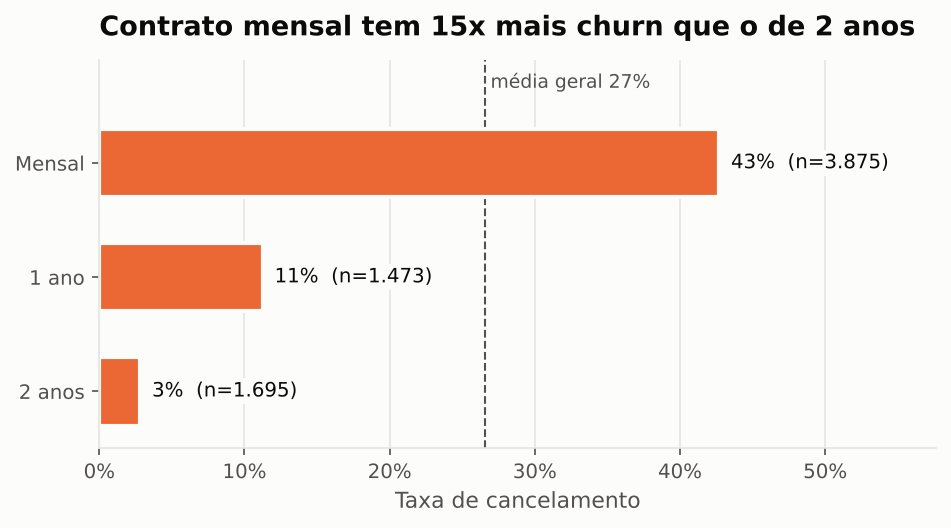
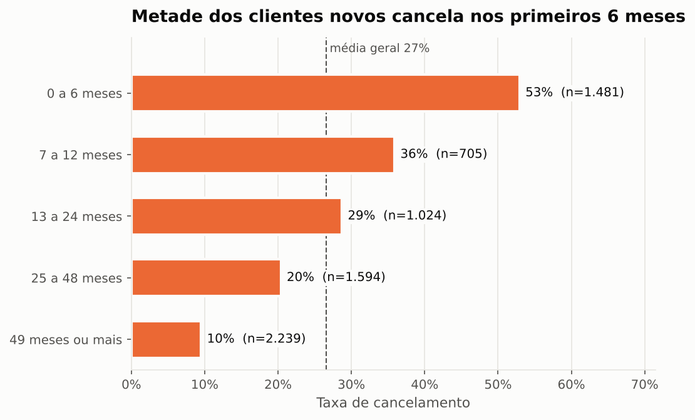
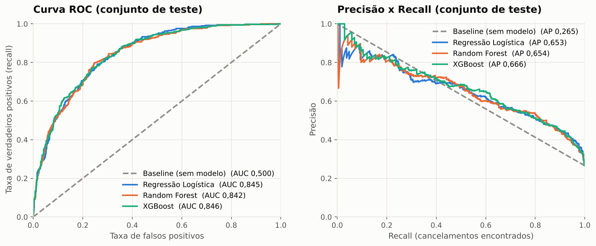
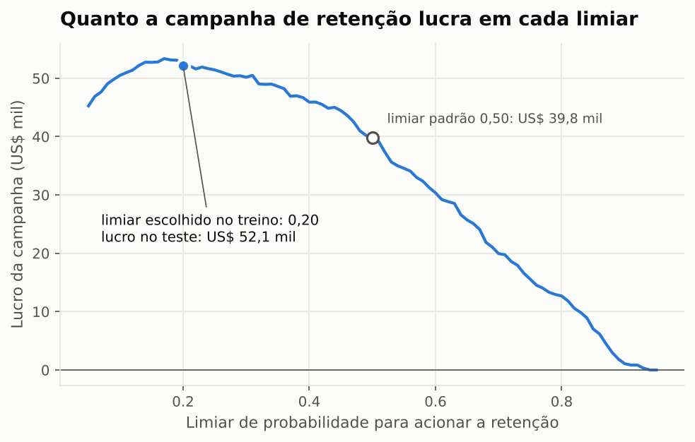
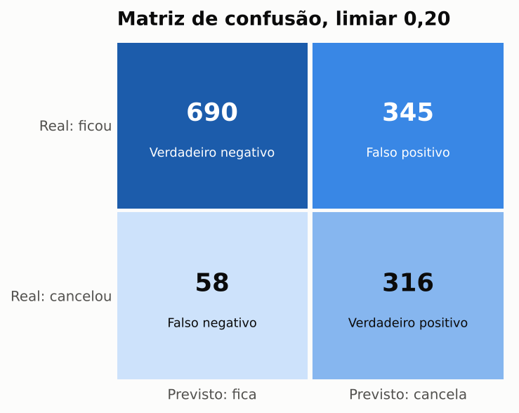
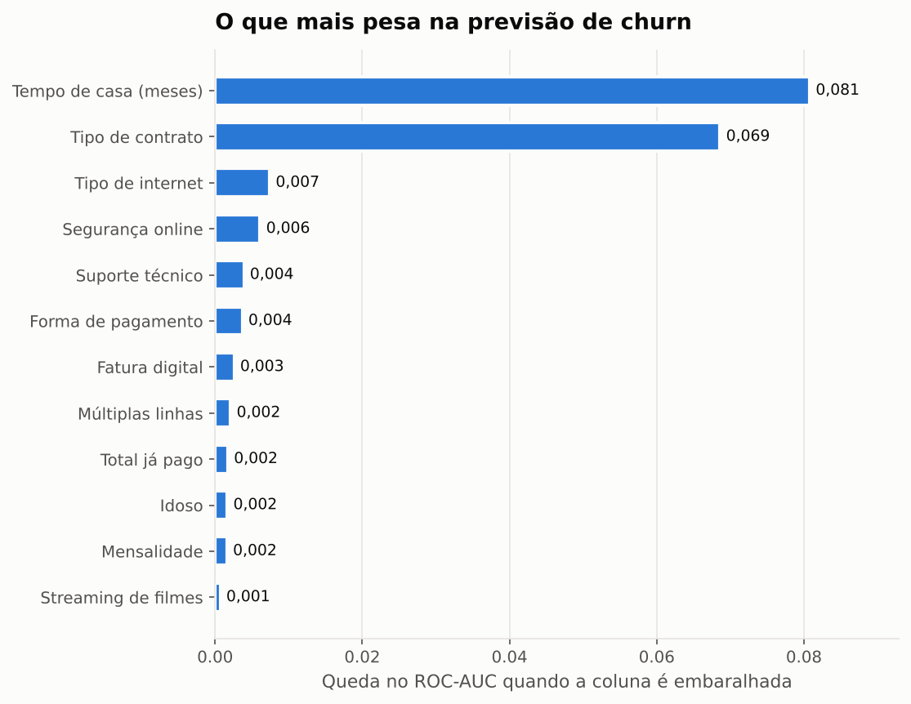
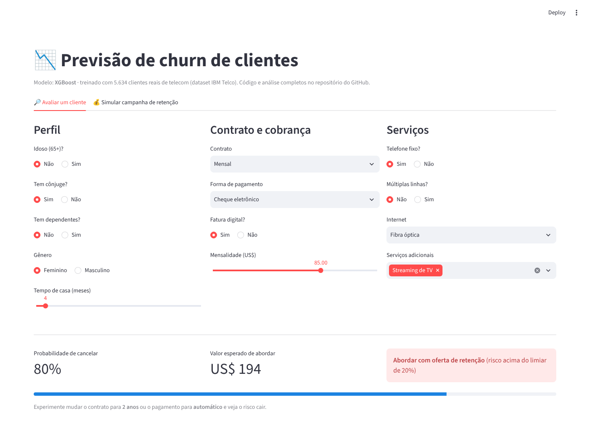

# Previsão de churn de clientes

[](https://github.com/fonsecaalari-gif/previsao-churn-clientes/actions)

Modelo que estima a probabilidade de cada cliente de uma operadora de telecom cancelar o serviço e indica quem deve receber uma oferta de retenção. O limiar de decisão foi escolhido pelo lucro da campanha, e não pelo valor padrão de 0,5.

[App online](https://previsao-churn-larissa.streamlit.app) · [Análise exploratória](notebooks/01_analise_exploratoria.ipynb) · [Modelagem](notebooks/02_modelagem.ipynb)

## Resultado

No conjunto de teste (1.409 clientes), a campanha guiada pelo modelo dá US$ 52 mil de lucro. É 31% a mais do que o mesmo modelo com limiar 0,5 e quase 4 vezes o lucro de abordar a mesma quantidade de clientes escolhidos ao acaso.

| Estratégia | Lucro no teste |
|---|---:|
| Não fazer nada | US$ 0 |
| Abordar clientes ao acaso (mesmo volume do modelo) | US$ 13.319 |
| Abordar todos os clientes | US$ 27.524 |
| Modelo com limiar 0,50 | US$ 39.814 |
| Modelo com limiar 0,20 (escolhido pelo lucro) | US$ 52.111 |

## Contexto

A empresa perde 26,5% dos clientes, e esses clientes somam 30,5% da receita mensal. Oferecer desconto para toda a base sai caro, então a pergunta é quais clientes vale a pena abordar.

Os dados são do [IBM Telco Customer Churn](https://github.com/IBM/telco-customer-churn-on-icp4d): 7.043 clientes e 21 colunas com perfil, serviços contratados, contrato e cobrança. Os valores estão em dólares.

## Análise exploratória

<table>
<tr>
<td></td>
<td></td>
</tr>
</table>

- No contrato mensal o churn é de 42,7%. No contrato de 2 anos, 2,8%.
- 55% dos cancelamentos acontecem no primeiro ano. Nos 6 primeiros meses o churn chega a 52,9%.
- Quem paga com cheque eletrônico cancela 45% das vezes, contra 15% de quem paga com cartão automático.
- Clientes com internet e sem nenhum serviço de segurança, backup ou suporte cancelam 56,7% das vezes.
- O grupo com contrato mensal, fibra óptica e até 12 meses de casa tem 70% de churn e reúne 13% da base.
- O gênero não muda a taxa de churn (26,9% contra 26,2%).

## Modelagem

Separei 20% dos clientes para teste antes de treinar os modelos e só usei esse conjunto uma vez, no final. Todo o pré-processamento fica dentro de um `sklearn.Pipeline`, e o limiar foi escolhido com previsões out-of-fold do treino.

| Modelo (validação cruzada, 5 folds) | ROC-AUC | PR-AUC |
|---|---:|---:|
| Baseline (sem modelo) | 0,500 | 0,265 |
| Random Forest | 0,844 ± 0,010 | 0,657 ± 0,024 |
| Regressão Logística | 0,847 ± 0,012 | 0,660 ± 0,015 |
| XGBoost | 0,847 ± 0,010 | 0,664 ± 0,022 |

Os três modelos ficaram empatados dentro da margem de erro. Escolhi o XGBoost porque teve a maior PR-AUC média, mas a Regressão Logística daria resultado parecido e é mais fácil de explicar.



### Escolha do limiar

Deixar de abordar um cliente que vai sair custa mais do que abordar um cliente que ficaria. Por isso calculei o lucro da campanha para cada limiar, com estas premissas (ajustáveis em [`config.py`](src/churn/config.py)):

| Premissa | Valor |
|---|---|
| Custo da oferta por cliente abordado | US$ 50 |
| Chance de a oferta reter quem iria sair | 30% |
| Receita preservada por cliente retido | 12 mensalidades |

<table>
<tr>
<td width="60%"></td>
<td width="40%"></td>
</tr>
</table>

Com limiar 0,20, o modelo encontra 84,5% dos clientes que iriam cancelar e aborda 47% da base. No teste, o ROC-AUC foi 0,846 e a PR-AUC 0,666.

### Variáveis mais importantes



Tempo de casa e tipo de contrato explicam a maior parte da previsão, o que bate com a análise exploratória.

## Recomendações

1. Oferecer desconto para quem trocar o plano mensal pelo anual nos primeiros 6 meses.
2. Dar um bônus na fatura para quem trocar o cheque eletrônico por débito ou cartão automático.
3. Incluir suporte técnico e segurança online sem custo nos primeiros meses para clientes de fibra.
4. Rodar o modelo todo mês para definir a lista de contatos da equipe de retenção.

## App

No [app](https://previsao-churn-larissa.streamlit.app) dá para calcular o risco de um cliente e simular a campanha com outras premissas de custo e taxa de sucesso.



## Estrutura

```
previsao-churn-clientes/
├── app/streamlit_app.py        # app (avaliação de cliente e simulador de campanha)
├── data/raw/                   # dataset original, sem alterações
├── models/modelo_churn.joblib  # pipeline treinado e limiar escolhido
├── notebooks/
│   ├── 01_analise_exploratoria.ipynb
│   └── 02_modelagem.ipynb
├── reports/
│   ├── figures/                # gráficos deste README
│   └── metrics.json            # métricas geradas pelo treino
├── src/churn/
│   ├── config.py               # caminhos e premissas de negócio
│   ├── data.py                 # leitura e limpeza
│   ├── features.py             # novas variáveis e pré-processamento
│   ├── business.py             # cálculo do lucro e escolha do limiar
│   ├── plots.py                # gráficos
│   └── train.py                # treino e avaliação
├── tests/                      # 18 testes (pytest)
└── .github/workflows/ci.yml    # roda testes e treino a cada push
```

## Como rodar

```bash
git clone https://github.com/fonsecaalari-gif/previsao-churn-clientes.git
cd previsao-churn-clientes
python -m venv .venv && source .venv/bin/activate   # Windows: .venv\Scripts\activate
pip install -r requirements.txt && pip install -e .

pytest -q                          # testes
python -m churn.train              # treina e gera métricas e gráficos (cerca de 30 s)
streamlit run app/streamlit_app.py # abre o app
```

## Limitações

- Os dados mostram um único momento. Histórico de uso, reclamações e atendimento devem melhorar o modelo.
- O custo da oferta e a taxa de sucesso são estimativas. Numa empresa, esses valores viriam de um teste A/B.
- Próximos passos: calibrar as probabilidades, gerar explicações por cliente com SHAP, monitorar drift e servir o modelo com FastAPI.

## Tecnologias

Python, pandas, scikit-learn, XGBoost, matplotlib, Streamlit, pytest e GitHub Actions.

---

Dados: [IBM Telco Customer Churn](https://github.com/IBM/telco-customer-churn-on-icp4d), licença Apache 2.0.

Larissa Fonseca · [LinkedIn](https://www.linkedin.com/in/larissa-fonseca-179885170/)
